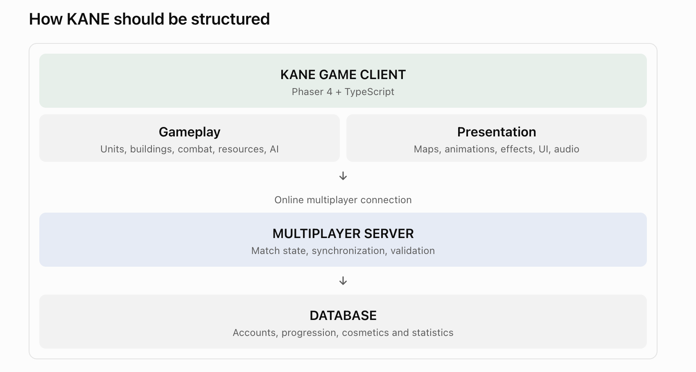

# KANE

**BUILD. COMMAND. CONQUER.**  
Fantasy Real-Time Strategy Game

Built with **[Phaser 4](https://phaser.io/phaser4)** (`phaser@^4.2.1`) + TypeScript + Vite.  
APIs: [docs.phaser.io](https://docs.phaser.io/) — do not assume Phaser 3.

> **Local-first.** Ads off (`adsEnabled=false`). Vite (`npm run dev`) is primary. Firebase Hosting preview is optional — see `docs/firebase-hosting.md`. Push/merge to **`dev`** auto-deploys Hosting via GitHub Actions (`FIREBASE_SERVICE_ACCOUNT_KANE_RTS_GAME`, via Firebase Hosting GitHub integration).

## Quick start

```bash
npm install
npm run dev
```

Open `http://localhost:5173` (use the LAN URL for phones).

Checks: `npm run lint` (ESLint), `npm test` (Vitest), `npm run build` (type-check + bundle).

## Current milestone — single-player rematch

Playable **battlefield** (select / move / attack / build / train):

- Camera: **WASD** / arrows, **edge scroll**, wheel or **`[` `]`** zoom
- Menu picks **Brutes**, **Nobles**, or **Weirdos**, plus Easy / Normal / Hard, then Rematch
- Brutes train Bonkers and Rock Throwers from the Bonker Hut, Wolf Riders and Big Bonkers from the Beast Pen, Stompers and Boom Goblins from Scrap Works
- **LMB** select · **Shift** add/toggle · **drag** box · **RMB** attack enemy or move
- Health bars, attack range when selected, death removal, no friendly fire

**Parked:** live multiplayer, Firebase friend lobby, ads, offline service worker.

## Architecture



| Layer | Path | Status |
|-------|------|--------|
| **KANE GAME CLIENT** (Phaser 4 + TS) | `src/game/`, `src/gameplay/`, `src/presentation/` | Yes |
| → Gameplay | `src/gameplay/` (+ `battlefield/` for M1) | Yes |
| → Presentation | `src/presentation/` | Yes |
| Species / units | `src/data/speciesStub.ts`, `src/data/units.ts` | Brutes, Nobles, Weirdos |
| Resources (later) | `src/data/resources.ts` | Stub — Scrap + Core IDs |
| Battlefield combat | `src/gameplay/battlefield/` | Select/move + combat |
| Online connection | `src/networking/` | Stub (lobby codes local-only) |
| Multiplayer server | `src/server/` | Stub |
| Database | `src/database/` | Local stats + persistence stub |
| Firebase foundation | `src/firebase/` | Email + anonymous Auth + Firestore account path (opt-in via env); 13+ positioning (no in-game gate); no live MP |

Gameplay does not import presentation. The skirmish loop lives in `gameplay/battlefield/` and `BattlefieldScene`.

## Controls (battlefield)

| Input | Action |
|-------|--------|
| LMB | Select unit |
| Double-click a unit (or Ctrl/Cmd+click) | Select every unit of that type |
| Shift+LMB | Add / toggle select |
| LMB drag | Multi-select box |
| Ctrl+A | Select all army |
| RMB on enemy | Attack |
| RMB on ground | Move selected |
| Touch: press and hold on the map | Same as RMB: attack an enemy, gather, or move |
| A, then click | Attack-move |
| S | Stop |
| Ctrl+0-9 (or Alt+0-9) | Save the selection as a control group |
| 0-9 | Select a group (Shift adds); press twice to centre the camera |
| WASD / arrows | Pan |
| Edge of screen | Pan |
| Wheel / `[` `]` | Zoom |
| Esc | Cancel, then pause |
| Menu | Back to title |

Full list, and how each key maps to StarCraft, Age of Empires and C&C: [docs/hotkeys.md](docs/hotkeys.md).

## Brand

- **KANE** · **BUILD. COMMAND. CONQUER.** · Fantasy Real-Time Strategy Game

## What’s next

Phase 6 (Firebase emulators + live friend lobby) stays parked. Match writes are still client-trusted. The coach shows once: finishing or skipping it keeps later matches quiet, and the menu Tips switch turns it back on. Ads stay off.
